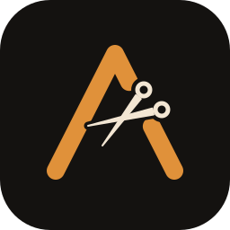
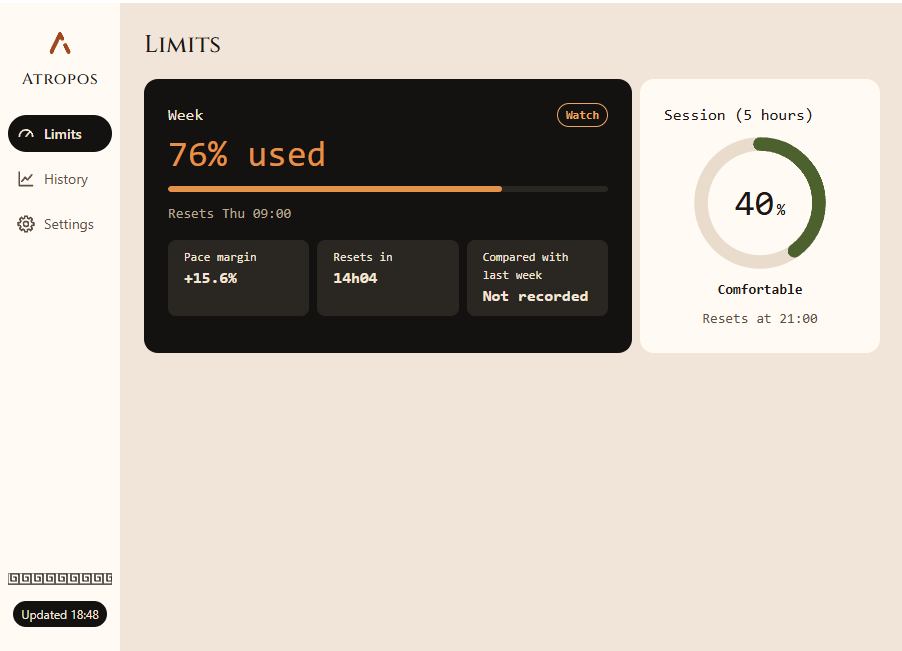
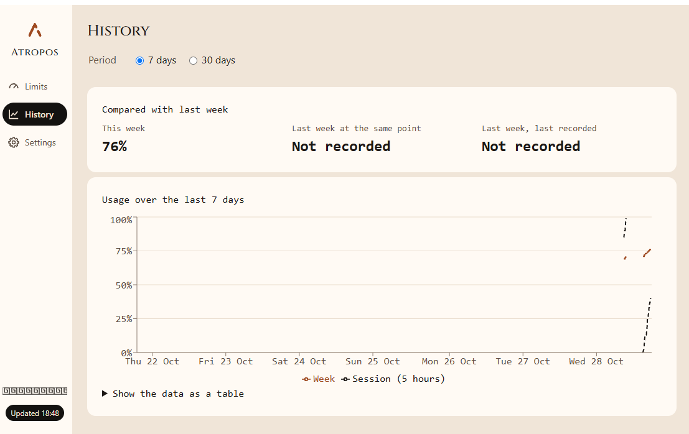
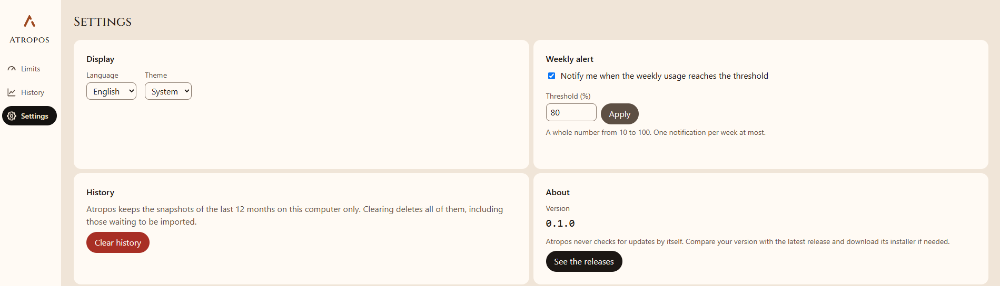
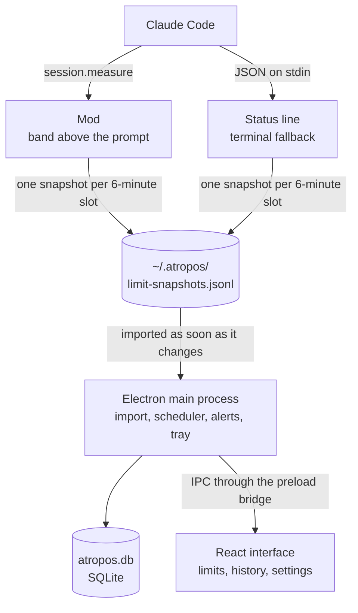

<p align="center">
  
</p>

<h1 align="center">Atropos</h1>

<p align="center">
  Live Claude Code usage limits on the Windows desktop: the 5-hour window and the weekly limit, with their history.
</p>

<p align="center">
  <a href="https://github.com/YoanCuervo/Atropos/releases/latest">Download for Windows</a>
  ·
  <a href="#privacy">Privacy</a>
  ·
  <a href="#how-it-works">How it works</a>
</p>

<picture>
  <source media="(prefers-color-scheme: dark)" srcset="docs/images/limits-dark.png">
  
</picture>

Works with Claude Code. Atropos only reads the limits that Claude Code gives its own extensions. It never reads your Claude credentials and never calls an Anthropic API.

## Features

- **Claude Code mod.** A band above the prompt shows the model, the context, the session cost and, for each limit, the share used, the pace margin and the time left. It runs in the terminal and in the Claude desktop app, and records the limits for the app.

  

- **Tray icon.** The weekly share used, in a tooltip next to the clock. Left click opens the window.
- **Current limits.** Gauges for the week and the 5-hour session, with their reset times and how far ahead or behind a steady pace you are.
- **History.** A 7-day or 30-day chart, the same data as a table, and a comparison with last week at the same point.

  

- **Weekly alert.** A Windows notification when the weekly limit reaches your threshold, 80 % by default, sent once per weekly window.
- **Settings.** English or French, System, Light or Dark theme, the alert, clearing the history, and the status line fallback.

  

## Install

### The app

1. Download `atropos-<version>-setup.exe` from the [latest release](https://github.com/YoanCuervo/Atropos/releases/latest).
2. Run it. It installs for the current user, without administrator rights. The installer is not code-signed, so Windows SmartScreen may ask you to confirm: **More info**, then **Run anyway**.

### The Claude Code mod

The mod is the data source. At the prompt of a Claude Code terminal session:

```
/plugin install atropos --marketplace YoanCuervo/Atropos#mod
```

Answer `y` to add the marketplace, then pick a scope. From a shell, the same command is `claude plugin install atropos --marketplace YoanCuervo/Atropos#mod`. A mod installed at the user scope also loads in the Claude desktop app.

Limits appear after the first reply of a session, and only for Claude Pro and Max plans.

### The status line, as a fallback

In a terminal session, the Claude Code status line can record the limits too. **Settings → Status line** in Atropos shows the block to paste into `~/.claude/settings.json`. Atropos never writes that file itself. The status line runs on the Node.js built into Atropos, so Node.js does not need to be installed.

## How it works



- The mod listens to `session.measure`, which Claude Code fires after each turn and whenever a limit moves by a whole point. It records at most one snapshot per limit and per 6-minute slot, aligned on the clock (:00, :06, :12…).
- The mod and the status line append to a shared JSON Lines journal. It lives in `%USERPROFILE%\.atropos\`, outside AppData, because the Claude desktop app virtualizes AppData for the processes it starts.
- The app imports the journal into SQLite, purges snapshots older than 12 months, refreshes the tray and decides on the weekly alert.

The code is split into one-way layers: `core/` holds the pure logic, with no Electron and no side effects. `mod/`, `statusline/` and `main/` use it, `preload/` exposes a closed list of channels, and `renderer/` only displays.

## Privacy

Atropos keeps everything on your computer.

- **What is stored:** for each snapshot, the 6-minute slot, the kind of limit (5-hour or weekly), the share used and the reset time. Nothing else.
- **What is never stored:** the Claude Code payload also carries the session id, the working directory and the transcript path. Atropos discards them. It never reads your prompts, your conversations or your Claude credentials.
- **No network:** no telemetry, no analytics, no update check. Fonts are bundled. The only link out is the releases page, opened in your browser when you click it.
- **Retention:** snapshots older than 12 months are deleted automatically. **Settings → Clear history** deletes them all at once.
- **Where the files are:**
  - `%USERPROFILE%\.atropos\limit-snapshots.jsonl`: the journal written by the mod and the status line.
  - `%USERPROFILE%\.atropos\settings.json`: language, theme and alert settings.
  - `%APPDATA%\Atropos\atropos.db`: the history database.

Uninstalling Atropos removes the app and `%APPDATA%\Atropos`, history database included. Delete `%USERPROFILE%\.atropos` to remove the journal and the settings too.

## Accessibility

- Every control works with the keyboard, with a visible focus.
- Text contrast is at least 4.5:1 in both themes, and colour is never the only signal.
- Each chart has an equivalent table.
- The `lang` attribute follows the chosen language.
- Animations respect `prefers-reduced-motion`.

## Development

Requires Node.js 24 and Windows.

```bash
npm install          # installs dependencies
npm run dev          # starts Electron with hot reload
npm test             # runs Vitest on core/
npm run lint         # runs ESLint
npm run build:win    # builds the Windows installer
```

`npm run build` also bundles the mod into `out/mod/`. To load it in Claude Code while developing, add that folder to `CLAUDE_CODE_PLUGIN_DIRS`, and check it with `claude plugin validate out/mod`.

**Stack:** Electron, electron-vite and React in JavaScript with JSDoc, `better-sqlite3`, Recharts, electron-builder (NSIS), Vitest, ESLint and Prettier. Pushing a `v*` tag builds the installer into a draft GitHub release, and publishing that release publishes the mod.

## Credits

- Inspired by [Agent Burn](https://github.com/Melvynx/agent-burn). Atropos shares no code with it.
- Titles use [Cinzel](https://github.com/NDISCOVER/Cinzel), under the SIL Open Font License.

Atropos is an independent project, not affiliated with or endorsed by Anthropic. Claude and Claude Code are trademarks of Anthropic.

## License

[MIT](LICENSE)
